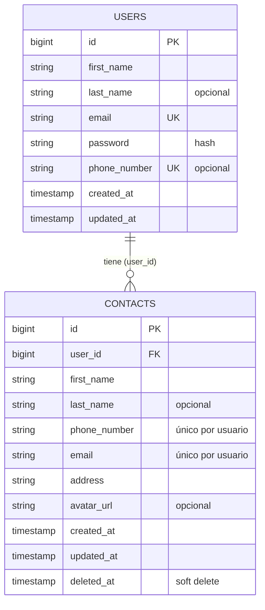

# Modelo de datos de Contact API

- Un usuario tiene muchos contactos; cada contacto pertenece a un solo usuario.
- Si se elimina un usuario, se eliminan sus contactos (`cascadeOnDelete`).
- En la tabla users, el email y el teléfono son únicos.
- En la tabla contacts, el email y el teléfono son únicos **dentro de la agenda de cada usuario** (`user_id + email` y `user_id + phone_number`): dos usuarios distintos sí pueden tener el mismo contacto. El nombre, el apellido y la dirección se pueden repetir.
- Al borrar un contacto se usa soft delete: se llena `deleted_at` y la fila se conserva.
