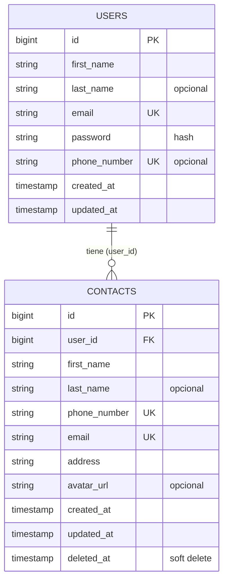

# Modelo de datos de Contact API

- Un usuario tiene muchos contactos; cada contacto pertenece a un solo usuario.
- Si se elimina un usuario, se eliminan sus contactos (`cascadeOnDelete`).
- El email y el teléfono no se pueden repetir. El nombre, el apellido y la dirección sí.
- Al borrar un contacto se usa soft delete: se llena `deleted_at` y la fila se conserva.
